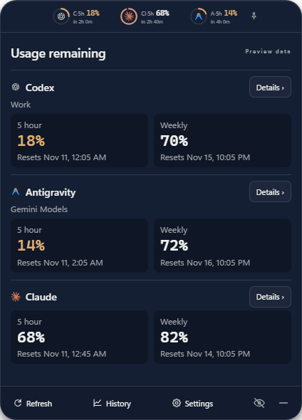

# YouSage

YouSage is a small Windows desktop companion for checking **Codex**, **Google Antigravity**, and **Claude Code** allowances. Glance at how much usage you have left and when it resets from a movable notch, then open the Detail panel to see your accounts and model quotas.

[Download Setup Wizard for Windows](https://github.com/yabswannalearn/yousage/releases/latest/download/YouSage-x64-setup.exe) · [Try the demo](https://yabswannalearn.github.io/yousage/?preview=1&expanded=1) · [Build from source](#build-from-source) · [Contribute](CONTRIBUTING.md)



## Install on Windows

YouSage targets **Windows 10 and 11 (x64)** and uses the Microsoft Edge WebView2 Runtime. Open the downloaded `YouSage-x64-setup.exe` to install YouSage for your Windows account. The release page also includes the standalone `yousage.exe`. [Release notes and assets](https://github.com/yabswannalearn/yousage/releases/latest)

The screenshot, browser demo, and instructions below describe `main`. The published [v0.1.0 release](https://github.com/yabswannalearn/yousage/releases/tag/v0.1.0) covers Codex and Antigravity usage. [Build from source](#build-from-source) to try the newer Detail panel, Claude Code support, coding session status, and automatic switching.

The published Windows binaries are unsigned. To verify a download, compare its SHA-256 hash with the digest for that asset on GitHub Releases. Replace the filename in this PowerShell command if you downloaded the standalone executable.

```powershell
Get-FileHash -LiteralPath .\YouSage-x64-setup.exe -Algorithm SHA256
```

### Update an existing installation

Download the latest Setup Wizard, quit YouSage from the tray, and run the wizard over your existing installation to keep your settings and history. On builds from `main`, open **Settings → System → Desktop & updates** to check for a newer release and select **Download update** when one is available.

## Get started

1. Install and sign in to the tools for the subscriptions you want to track.
2. Launch YouSage and choose your subscriptions in the first-run setup.
3. Hover over the top edge of the notch to open the Detail panel, or choose **Open usage details** from the Windows system tray.

| Subscription | Sign-in and account setup |
| --- | --- |
| Codex | Sign in to Codex on this PC. To connect another ChatGPT account, open **Codex → Details → Add Codex account**. |
| Antigravity | Install and sign in to the `agy` CLI. The Antigravity detail view shows model quotas and lets you save the current sign-in. |
| Claude Code | Run `claude auth login` to sign in to your Claude subscription. The Claude detail view lets you save the current sign-in. |

Click inside the Detail panel to pin it open. Click outside or press **Esc** to close it. Drag the expanded header to move or dock the notch. Press **Alt+Shift+U** to toggle the notch, **Alt+Shift+N** to cycle its preview, or **Alt+Shift+P** to toggle privacy mode.

## What you can do

- **Check allowance at a glance.** See five-hour and weekly readings, Antigravity model quotas, and Claude’s separate Fable weekly allowance when reported. Open **Settings → Preview** to show up to three counters and arrange their positions.
- **Track coding sessions.** Choose **Enable session status** under **Settings → Preview → Coding sessions** to see which conversations are working, waiting for permission, or finished. Review and approve the new hooks in Codex before starting new sessions. [Session setup notes](docs/development.md#hover-session-status-and-claude-switching)
- **Switch saved accounts.** Review the affected sessions before switching. Automatic switching is opt-in per subscription and waits for sessions to close by default. The separate force-close option can interrupt tasks and lose unsaved work. [Account switching details](docs/development.md#account-switching)
- **Review usage trends.** Set allowance and reset alerts, open **History** to see usage and pacing estimates, and choose **Export CSV** to save a copy.

## Help and privacy

For missing or stale readings, open **Settings → System → Connection health**. It shows the last successful check, the next retry, and any available sign-in steps. Claude readings rely on an internal endpoint and can be affected by rate limits or upstream changes. Use **Settings → Preview → Background tracking** to pause a provider and **Refresh** to check it on demand.

YouSage stores usage history and session status on your PC. Privacy mode masks account and conversation names in the interface and uses generic notifications. Manage history retention under **Settings → System**. [Provider integrations and local data](docs/development.md#integration)

Use [GitHub Issues](https://github.com/yabswannalearn/yousage/issues) for bugs and feature requests. Follow the [security policy](SECURITY.md) to report vulnerabilities privately.

## Build from source

On Windows, install Git, Node.js 22.12 or newer, Rust 1.90 or newer with the MSVC toolchain, Microsoft C++ Build Tools, the Windows SDK, and WebView2. [Tauri prerequisites for Windows](https://v2.tauri.app/start/prerequisites/#windows)

```powershell
git clone https://github.com/yabswannalearn/yousage.git
cd yousage
npm ci
npm run tauri dev
```

Run `npm run build:desktop` for the standalone executable at `src-tauri/target/release/yousage.exe`, or `npm run tauri build` for the NSIS installer under `src-tauri/target/release/bundle/nsis/`.

For a local browser preview with sample data, run `npm run dev` and open [the demo at localhost](http://127.0.0.1:1420/?preview=1&expanded=1). Use the Windows app to connect real accounts.

## Contributing

Bug reports, documentation fixes, and pull requests are welcome. The [contribution guide](CONTRIBUTING.md) explains how to report an issue and run the checks. See the [product brief](docs/product-brief.md), [interface design](docs/design.md), and [development notes](docs/development.md) for project context.

## License and credits

YouSage is an independent project. Its source code is dual-licensed under the [MIT License](LICENSE) or [Apache License 2.0](LICENSE-APACHE), at your option. See the [maintainer profile](https://github.com/yabswannalearn) and [project contributors](https://github.com/yabswannalearn/yousage/graphs/contributors).

Provider marks identify their usage sources. [ChatGPT favicon](https://chatgpt.com/cdn/assets/favicon-o20kmmos.svg) · [Claude icon](https://claude.com/icon.svg) · [Antigravity press assets](https://antigravity.google/press)
